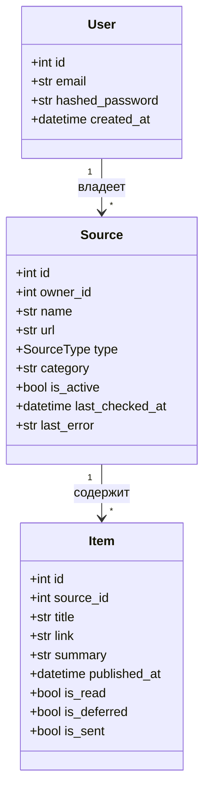

# ContentHarvest

Веб-сервис для персональной агрегации контента: собирает новые материалы из выбранных источников (RSS/Atom и статические страницы), хранит их в архиве и присылает ежедневный email-дайджест.

**Сервис:** https://contentharvest.online · **Заявка:** [final_application.md](final_application.md) · **Сценарии:** [final_userscripts.md](final_userscripts.md) 

## Возможности
1. Управление источниками (добавление, редактирование, удаление, ручная проверка)
2. Автоматический ежедневный парсинг (RSS/Atom, HTML по CSS-селекторам)
3. Веб-архив с пометками «прочитано / не прочитано»
4. Категории источников
5. Ежедневный email-дайджест (Jinja2)
6. Отложенное прочтение: материал попадает в следующее письмо
7. Экспорт архива в CSV (ссылка «Экспорт CSV» в меню)
8. Статистика: собрано и прочитано за период, по источникам
9. Поиск по заголовкам и описанию, фильтры по категории и статусу; по источнику и дате публикации — через REST API
10. Регистрация: у каждого пользователя свои данные
11. Раздел "Помощь"

## Стек и обоснование выбора
| Инструмент | Зачем |
|---|---|
| Python 3.11 | Богатая экосистема для парсинга и бэкенда, язык, которым я владею лучше всего |
| FastAPI + Uvicorn | Один фреймворк и для REST API, и для серверных страниц; автоматическая документация `/docs` |
| SQLAlchemy + SQLite | ORM позволяет сменить БД на PostgreSQL заменой `DATABASE_URL`; SQLite достаточно для MVP и не требует отдельного сервера |
| Jinja2 | Шаблоны страниц и писем на одном движке |
| feedparser, requests, BeautifulSoup | Разбор RSS/Atom; загрузка страниц с таймаутом; разбор HTML по селекторам |
| APScheduler | Фоновый ежедневный обход и рассылка внутри приложения, без отдельного сервиса |
| smtplib | Отправка писем через любой SMTP-сервер без внешних зависимостей |
| pytest, ruff | Модульные тесты и проверка стиля кода (PEP 8) |
| Docker, GitHub Actions, Amvera | Воспроизводимая сборка и проверка запуска в CI |

## Модель данных


## Структура
- `app/main.py` — страницы и точка входа; `app/routers/` — REST API
- `app/parser.py` — сбор материалов; `app/scheduler.py` — расписание; `app/mailer.py` — дайджест
- `app/models.py`, `app/database.py` — модели и подключение к БД
- `app/templates/`, `app/static/` — интерфейс; `tests/` — тесты

## Запуск локально
```bash
python -m venv .venv && source .venv/bin/activate
pip install -r requirements.txt
uvicorn app.main:app --reload
```
Переменные окружения: `SECRET_KEY`, `DATABASE_URL`, `SMTP_HOST`, `SMTP_PORT`, `SMTP_USER`, `SMTP_PASSWORD`, `MAIL_FROM`, `TIMEZONE`.

## Тесты
```bash
pytest -q
```

## CI/CD
- `.github/workflows/tests.yml` — проверка стиля (ruff) и тесты при каждом push
- `.github/workflows/docker.yml` — сборка Docker-образа и проверка запуска контейнера
- Хостинг: Amvera (`amvera.yaml`, точка входа `run.py`)
  
## Ограничения
- HTML-парсер не видит материалы, которые сайт подгружает через JavaScript: сервис сообщает об этом пользователю.
